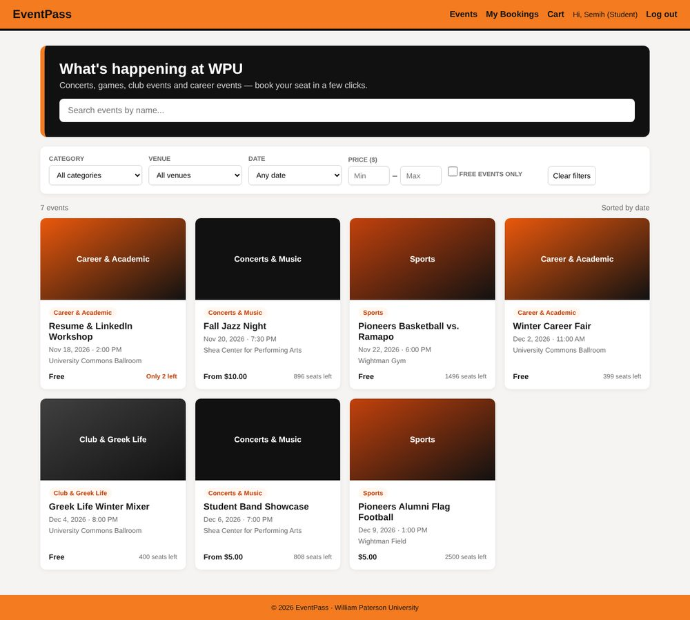

# EventPass: Event Ticket Booking System

A web app where William Paterson University students browse campus events, add tickets to a cart
and book them online. Organizers create and manage events; admins approve events and see sales
and attendance reports. Database Systems group project.

**Team:** Kshitij Kshitij · Millind Patel · Semih Aksehirli · Josh Choi



## Project structure

```
eventpass/
├── frontend/          HTML/CSS/JS screens (runs on fake data until the back end is ready)
└── docs/screenshots/  every screen, desktop and phone
```

## Run the front end

Open `frontend/login.html` with VS Code's Live Server and log in as
`doej@student.wpunj.edu` / `jane1234` (student), `lopezm@wpunj.edu` / `staff123` (organizer)
or `admin@wpunj.edu` / `admin123` (admin).

See [`frontend/README.md`](frontend/README.md) for which screen covers each feature and
which endpoints the front end calls.

## How we work in this repo

1. Pull the latest code before you start: `git pull`
2. Make a branch for your work: `git checkout -b your-feature`
3. Commit often with clear messages
4. Push the branch and open a **Pull Request** into `main`

Questions about the front end? Contact Semih Aksehirli.
